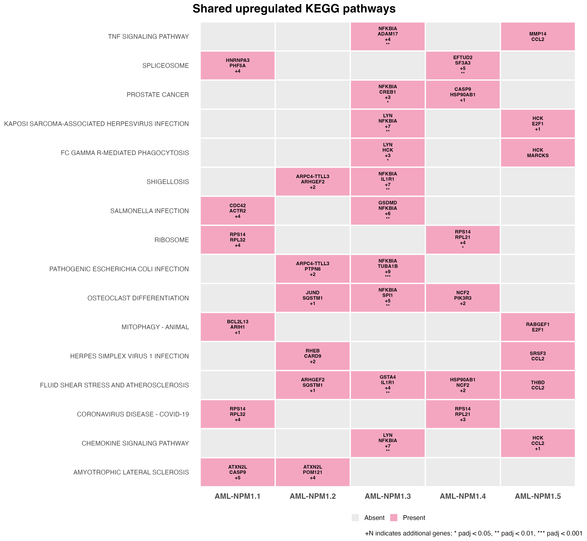

# Representative analysis figure

## Figure description

This figure compares shared KEGG pathways among candidate genes
associated with increased H3K27ac ChIP-seq signal across five NPM1
groups.

Candidate genes were identified using rGREAT associations within
3 kb of a transcription start site and pooled by NPM1 group.
KEGG enrichment was performed using Enrichr. The top 16 pathways
per group were ranked by adjusted p-value, followed by raw p-value.
Pathways with at least two overlapping candidate genes were retained;
those appearing in at least two groups are shown.

- **Rows:** shared KEGG pathways.
- **Columns:** the five NPM1 groups.
- **Pink tiles:** pathways present in that group's filtered top-16 results.
- **Grey tiles:** pathways absent from that group's filtered top-16 results.
- **Gene labels:** up to two overlapping candidate genes per tile.
  `+N` indicates the number of additional overlapping genes.
- **Asterisks:** enrichment adjusted p-values:
  * < 0.05, ** < 0.01, and *** < 0.001.
  Tiles without asterisks do not indicate significance below 0.05.

## Interpretation

The plot highlights similarities and differences in pathway
representation across NPM1 groups. Grey tiles do not demonstrate
biological absence of a pathway. Increased H3K27ac signal does not
by itself establish increased gene expression or pathway activation.

This figure was generated from the full research analysis and cannot
be reproduced using the single example input alone.

## Generation

Generated using
`11_plotting_shared_pathways_with_genes_batch.R`,
following the enrichment and pathway-filtering stages described
in the [workflow documentation](../h3k27ac_differential_peak_analysis/README.md).
